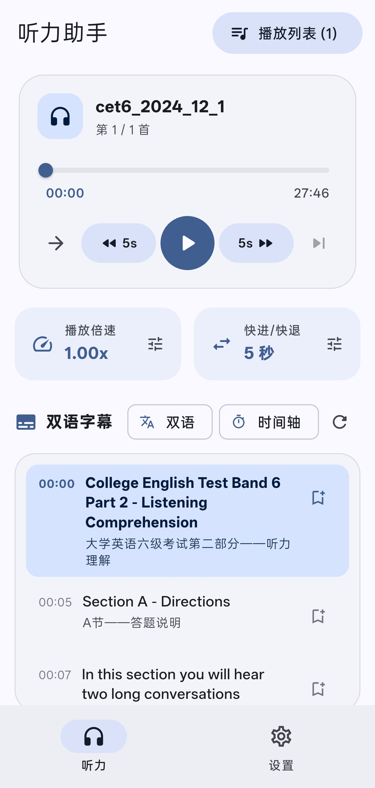
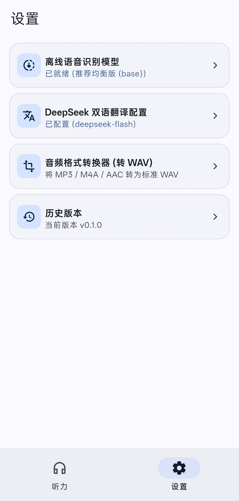

<div align="center">
  
  <h1>听力助手 · ListenMate</h1>
  <p>一款基于 Flutter 与端侧 Whisper 离线语音识别的大学英语四、六级精听工具</p>

  <p>
    <a href="https://github.com/Bamlax/listenmate/releases/latest">
      
    </a>
    <a href="https://github.com/Bamlax/listenmate/releases">
      
    </a>
    <a href="https://flutter.dev">
      
    </a>
    <a href="LICENSE">
      
    </a>
  </p>
</div>

## 界面预览

| 听力精听与双语字幕 | 设置与模型管理 |
| :---: | :---: |
|  |  |

## 核心功能

- **精听播放控制**：支持 `0.50x ~ 2.00x` 连续自定义播放倍速、自定义快进/快退秒数，以及顺序播放、单曲循环、列表循环模式切换。
- **时间轴节点标注**：听到没听清的句子一键打点标注，支持自定义备注与进度条可视化刻度，点击任意标注卡片即可立即跳回对应时间点反复精听。
- **离线识别 + AI 双语字幕**：
  - **零费用端侧识别**：内置 `whisper.cpp` 推理引擎，支持在设置页按需下载 `tiny`（~75 MB）或 `base`（~142 MB）离线模型（内置国内镜像与 HuggingFace 官方源自动容错切换）。
  - **AI 双语对照与盲听模式**：接入 DeepSeek API（默认 `deepseek-flash`）自动翻译为地道中文，支持「双语 / 仅英文 / 隐藏（盲听）」切换、点击单句跳转精听及实时时间轴微调。
- **原生硬件音频转换器**：基于 Android 原生 `MediaExtractor` 与 `MediaCodec` 实现硬件解码与重采样，自动将 MP3 / M4A / AAC 等转为 16kHz 单声道 PCM WAV 供识别使用，也支持在设置页手动转换导出。
- **应用内更新检测**：启动时自动检测 GitHub Releases 最新版本，发现新版时提示更新日志并提供直达下载入口。

## 下载与使用

1. 前往 [GitHub Releases](https://github.com/Bamlax/listenmate/releases/latest) 下载最新的 `listenmate-vX.X.X.apk` 并安装到 Android 手机。
2. 打开「听力助手」，切换至底部 **「设置」→「离线语音识别模型」**，按需下载 `base` 或 `tiny` 模型。
3. （可选）进入 **「设置」→「DeepSeek 双语翻译配置」** 填入 API Key；未配置 Key 也可正常离线生成纯英文字幕。
4. 点击主界面右上角 **「播放列表」** 导入本地听力音频，即可开始精听训练。

## 本地开发与编译

本项目已在 `android/app/build.gradle.kts` 中配置自动签名回退机制：当本地不存在 `android/key.properties` 正式签名配置时，将自动使用 `debug` 签名构建，克隆仓库后无需额外配置密钥即可直接运行：

```bash
git clone [https://github.com/Bamlax/listenmate.git](https://github.com/Bamlax/listenmate.git)
cd listenmate
flutter pub get
flutter run